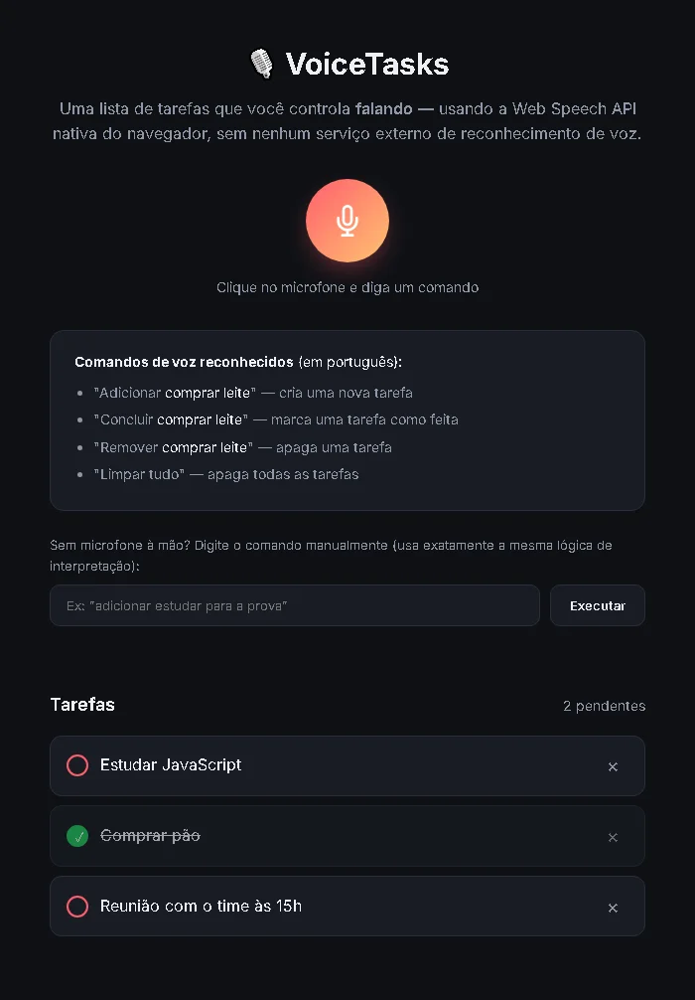

# VoiceTasks — Lista de Tarefas por Comando de Voz

Uma lista de tarefas controlada **falando com o navegador**, usando a **Web Speech API**
nativa (sem nenhum serviço externo de reconhecimento de voz, sem chave de API). Um modelo
de interação bem diferente dos apps de tarefas tradicionais do portfólio.

**Demo:** https://miltonsilvaa.github.io/voice-todo-list/



## ✨ Como funciona

Clique no botão do microfone e diga um comando em português:

| Comando de voz | Ação |
|---|---|
| "Adicionar *comprar leite*" | Cria uma nova tarefa |
| "Concluir *comprar leite*" (ou "finalizar", "marcar ... como feita") | Marca uma tarefa como feita |
| "Remover *comprar leite*" (ou "apagar", "excluir") | Apaga uma tarefa |
| "Limpar tudo" | Remove todas as tarefas |

A busca ignora acentos e maiúsculas ("concluir comprar pao" encontra "Comprar pão"), dá
prioridade ao título exato sobre correspondências parciais e, ao concluir, prefere tarefas
ainda pendentes. O título salvo preserva acentos e maiúsculas do que foi dito.

O app também **fala de volta** a confirmação de cada ação (`SpeechSynthesisUtterance`),
criando um ciclo de interação totalmente por voz.

## 🧠 Arquitetura: um único interpretador de comandos

O núcleo do projeto é `js/commands.js`: funções **puras** (sem DOM, sem estado) que recebem
texto livre, não importa se veio do microfone ou foi digitado, e devolvem um comando
estruturado (`{ type: "add", title: "Comprar pão" }`). O `js/script.js` só executa o
comando e atualiza a tela.

Isso significa que **a lógica de comandos é testável sem microfone e sem navegador**, e o
campo de texto abaixo do microfone passa exatamente pelo mesmo caminho de código.

## ✅ Testes

```bash
npm test   # node --test, sem nenhuma dependência
```

`tests/commands.test.js` cobre o interpretador: extração de título com acentos, pontuação
que o reconhecimento de voz coloca no fim da frase ("Limpar tudo."), sinônimos dos
comandos, entradas vazias/inválidas e as regras de busca (acentos, título exato vs.
parcial, preferência por tarefas pendentes).

O fluxo na interface (adicionar, concluir, remover, persistência após recarregar, escape
de HTML nos títulos, layout mobile) foi verificado com Playwright pelo campo de texto.

**Sobre o reconhecimento de voz real:** a captura de áudio depende de permissão do usuário
e de um microfone, algo que não dá para automatizar de forma confiável. O fluxo de voz
completo deve ser conferido manualmente; a parte que decide o que fazer com o texto
transcrito é coberta pelos testes.

## 🛠️ Stack

- HTML5, CSS3, JavaScript puro
- Web Speech API (`SpeechRecognition` + `SpeechSynthesis`) — nativa do navegador
- `localStorage` para persistência
- `node:test` para os testes do interpretador

## ▶️ Como rodar

Acesse a [demo](https://miltonsilvaa.github.io/voice-todo-list/) ou sirva a pasta
localmente (ex: `npx serve .`) e abra num navegador com suporte à Web Speech API
(Chrome/Edge têm o melhor suporte). Permita o acesso ao microfone quando solicitado.

O reconhecimento de voz exige contexto seguro (`https://` ou `localhost`): abrindo o
`index.html` direto do disco, o microfone pode não funcionar. O campo de texto funciona
em qualquer caso.
